<a href="#selected-work">
<picture>
  <source media="(prefers-color-scheme: dark)" srcset="assets/hero-dark.svg">
  
</picture>
</a>

I build systems that keep working after you stop watching: agents, the infrastructure they run on, and the surfaces people meet them through. Electrical and computer engineer, teaching and researching in Puerto Rico, building under [Abstracto](https://abstracto.dev).

<picture>
  <source media="(prefers-color-scheme: dark)" srcset="assets/calendar-dark.svg">
  
</picture>

## Selected work

<table align="center" width="100%">
<tr><td width="50%"><a href="#selected-work"><picture><source media="(prefers-color-scheme: dark)" srcset="assets/work-fleet-dark.svg"></picture></a></td><td width="50%"><a href="#selected-work"><picture><source media="(prefers-color-scheme: dark)" srcset="assets/work-map-dark.svg"></picture></a></td></tr>
<tr><td width="50%"><a href="#selected-work"><picture><source media="(prefers-color-scheme: dark)" srcset="assets/work-sort-dark.svg"></picture></a></td><td width="50%"><a href="https://github.com/Marioindy/portfolio-website"><picture><source media="(prefers-color-scheme: dark)" srcset="assets/work-portfolio-dark.svg"></picture></a></td></tr>
<tr><td colspan="2" align="center"><table width="50%" align="center"><tr><td><a href="https://github.com/Marioindy/dnd-shadowkeep-campaign-manager"><picture><source media="(prefers-color-scheme: dark)" srcset="assets/work-dnd-dark.svg"></picture></a></td></tr></table></td></tr>
</table>

01, 02 and 03 are private, so they have no links. 04 and 05 open their repositories.

<picture>
  <source media="(prefers-color-scheme: dark)" srcset="assets/index-dark.svg">
  
</picture>

[LinkedIn](https://www.linkedin.com/in/jesielcarro) · [Abstracto](https://abstracto.dev) · [Repositories](https://github.com/Marioindy?tab=repositories)

<picture>
  <source media="(prefers-color-scheme: dark)" srcset="assets/ribbon-dark.svg">
  
</picture>

Every graphic here is an animated SVG drawn by [`scripts/build.mjs`](scripts/build.mjs), no third-party services. The calendar is redrawn daily by a [workflow](.github/workflows/calendar.yml). Motion respects reduced-motion settings.
